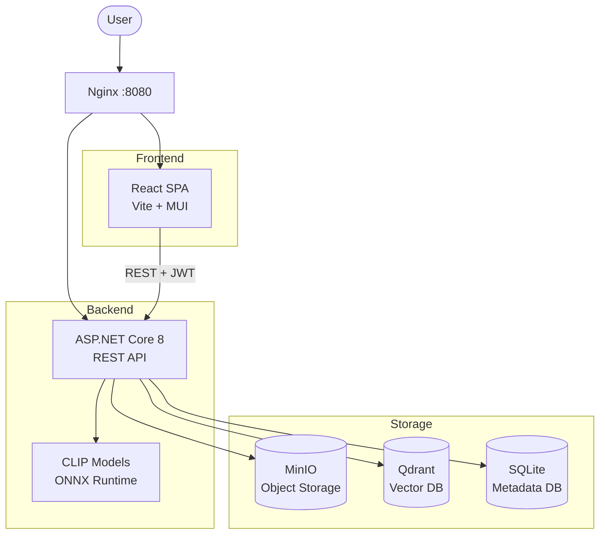
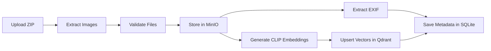
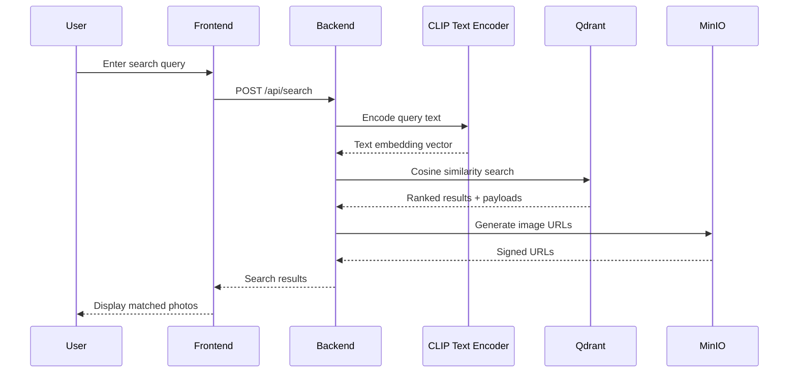

# AzurePhotoFlow

AI-powered photo management with semantic search.

AzurePhotoFlow is a cloud-native application that lets you manage, analyze, and search photo collections using natural language. It combines OpenAI's CLIP model for semantic understanding with a fully self-hosted, open-source infrastructure stack — no cloud API costs for AI inference.

## Features

- **Semantic Search** — Type natural language queries (e.g., "sunset over mountains") and find matching photos via CLIP text-to-image similarity
- **Visual Similarity Search** — Upload a reference image to find visually similar photos using CLIP vision embeddings
- **Bulk Upload** — Upload ZIP archives with automatic extraction, project organization, and batch processing
- **Face Recognition & Tagging** — Detect and tag individuals across your photo library
- **OCR Text Extraction** — Extract and index text found within images
- **EXIF Metadata Processing** — Automatically extract camera settings, GPS coordinates, timestamps, and other metadata
- **Google OAuth Authentication** — Secure login with Google accounts and JWT-based API authorization
- **Project-based Organization** — Organize photos by year and project in a hierarchical structure

## Architecture Overview



The system follows a cloud-native architecture with all components running as Docker containers. The backend handles AI inference locally using ONNX Runtime, eliminating external API costs. MinIO provides S3-compatible object storage, Qdrant stores vector embeddings for similarity search, and SQLite tracks image GUID mappings and metadata.

## Tech Stack

| Layer | Technology | Purpose |
|-------|-----------|---------|
| Frontend | React 18, Vite 6, Material-UI 6 | SPA with responsive photo management UI |
| Backend | ASP.NET Core 8 | REST API with clean architecture |
| AI/ML | OpenAI CLIP, ONNX Runtime | Vision & text embeddings for semantic search |
| Object Storage | MinIO | S3-compatible image storage |
| Vector Database | Qdrant | Embedding storage & similarity search |
| Metadata DB | SQLite + EF Core | Image GUID mapping & metadata |
| Auth | Google OAuth 2.0 + JWT | Authentication & authorization |
| Reverse Proxy | Nginx | Request routing & load balancing |
| Orchestration | Docker Compose / Kubernetes | Container management |
| IaC | Terraform | Infrastructure provisioning |
| CI/CD | Azure Pipelines, GitHub Actions | Build, test, deploy automation |

## How It Works

### Image Upload Pipeline



When a user uploads a ZIP archive, the backend extracts individual images, validates file types, and stores originals in MinIO under a year/project hierarchy. In parallel, EXIF metadata is extracted and the CLIP vision encoder generates embedding vectors. These vectors are upserted into Qdrant with payload metadata, and GUID mappings are persisted in SQLite.

### Semantic Search



The CLIP text encoder converts the natural language query into the same embedding space as the image vectors. Qdrant performs cosine similarity search to find the closest matches, and the backend resolves image URLs from MinIO for display.

### Authentication

Users authenticate via Google OAuth. The backend validates the Google token, generates a JWT (HS256, 7-day expiry) with user claims, and returns it to the frontend. The frontend stores the JWT in localStorage, and an Axios interceptor attaches it to all subsequent API requests.

## AI/ML: CLIP Model Integration

[CLIP](https://openai.com/index/clip/) (Contrastive Language-Image Pre-training) by OpenAI maps both images and text into a shared embedding space. This enables semantic search — a text query like "red car on a highway" produces a vector that is geometrically close to images matching that description.

AzurePhotoFlow supports three CLIP model variants:

| Variant | Dimensions | Model | Trade-off |
|---------|-----------|-------|-----------|
| Base | 512 | `clip-vit-base-patch32` | Fastest, lowest resource usage |
| Large | 768 | `clip-vit-large-patch14` | Balanced accuracy & performance |
| Huge | 1024 | `clip-vit-huge-patch14` | Best accuracy, most resource intensive |

Models are exported to ONNX format for cross-platform inference via ONNX Runtime. Text input is tokenized using CLIP's BPE tokenizer with a maximum sequence length of 77 tokens.

## Project Structure

```
AzurePhotoFlow/
├── frontend/              — React SPA (Vite + Material-UI)
├── backend/               — .NET solution
│   ├── AzurePhotoFlow.Api/       — Main Web API
│   ├── AzurePhotoFlow.Functions/ — Background processing
│   ├── AzurePhotoFlow.POCO/      — Shared data models & DTOs
│   └── AzurePhotoFlow.Shared/    — Shared utilities
├── models/                — ONNX models & tokenizer files
├── k8s/                   — Kubernetes manifests
├── infrastructure/        — Terraform IaC
├── scripts/               — Automation scripts
│   ├── setup/             — Project setup & configuration
│   ├── ai-ml/             — Model export & management
│   ├── deployment/        — CI/CD utilities
│   ├── monitoring/        — K8s monitoring
│   └── debugging/         — Debug tools
├── tests/                 — Test suites (backend + frontend)
├── docs/                  — Extended documentation
├── docker-compose.yml     — Local development orchestration
└── Makefile               — Development command shortcuts
```

## Getting Started

### Prerequisites

- .NET 8 SDK
- Node.js 18+ and npm
- Docker and Docker Compose
- Python 3.8+ (for CLIP model export)
- Git

### Quick Start

```bash
git clone https://github.com/<your-org>/AzurePhotoFlow.git
cd AzurePhotoFlow
make setup    # Install dependencies, export CLIP models, configure .env
make dev      # Build and start all services via Docker Compose
```

The application will be available at `http://localhost:8080`.

### Manual Setup

#### 1. Export CLIP Models

Create a Python virtual environment and export the ONNX models:

```bash
python scripts/ai-ml/setup_venv.py --path .venv
source .venv/bin/activate

# Auto-export based on .env configuration (recommended)
python scripts/ai-ml/auto_export_models.py

# Or manually specify a variant
python scripts/ai-ml/export_clip_onnx.py --variant base --output models
```

This produces `models/vision_model.onnx`, `models/text_model.onnx`, and `models/tokenizer/`.

#### 2. Backend

```bash
cd backend/AzurePhotoFlow.Api
dotnet restore
dotnet build
dotnet run    # Starts on http://localhost:5000
```

#### 3. Frontend

```bash
cd frontend
npm install
npm run dev   # Starts Vite dev server
```

#### 4. Docker Compose (all services)

```bash
docker compose up --build
```

### Service Endpoints

| Service | URL | Notes |
|---------|-----|-------|
| Application | http://localhost:8080 | Via Nginx reverse proxy |
| Backend API | http://localhost:5001 | Direct backend access |
| MinIO Console | http://localhost:9001 | Credentials: `minioadmin:minioadmin` |
| Qdrant Dashboard | http://localhost:6333/dashboard | Vector DB admin UI |

## Configuration

### Key Environment Variables

Copy `.env` and configure:

| Variable | Description | Example |
|----------|-------------|---------|
| `VITE_GOOGLE_CLIENT_ID` | Google OAuth client ID | `123...apps.googleusercontent.com` |
| `JWT_SECRET_KEY` | JWT signing key | (random string) |
| `MINIO_ENDPOINT` | MinIO server endpoint | `http://localhost:9000` |
| `QDRANT_HOST` | Qdrant hostname | `localhost` |
| `QDRANT_PORT` | Qdrant port | `6333` |
| `QDRANT_COLLECTION` | Collection name | `image-embeddings` |
| `CLIP_MODEL_PATH` | Path to ONNX vision model | `/models/vision_model.onnx` |
| `ENABLE_EMBEDDINGS` | Enable AI processing | `true` |
| `EMBEDDING_DIMENSION` | Embedding vector size | `512`, `768`, or `1024` |
| `EMBEDDING_MODEL_VARIANT` | CLIP model variant | `base`, `large`, or `huge` |
| `MAX_UPLOAD_SIZE_MB` | Max upload size in MB | `100` |
| `OPENAI_API_KEY` | OpenAI API key (optional) | `sk-...` |

### Switching Embedding Dimensions

```bash
make models-512    # Base model (512D) — fastest
make models-768    # Large model (768D) — balanced
make models-1024   # Huge model (1024D) — most accurate
```

> **Note:** Changing embedding dimensions requires recreating Qdrant collections, as existing vectors will be incompatible with the new dimensionality.

## Deployment

- **Local development** — `docker compose up` starts all services. See `docker-compose.yml`.
- **Production (Kubernetes)** — MicroK8s-based deployment with Nginx ingress. See `k8s/` manifests and [GETTING_STARTED.md](GETTING_STARTED.md).
- **Infrastructure as Code** — Terraform configurations in `infrastructure/` for provisioning cloud resources.

## Testing

```bash
# Backend tests
cd tests/backend && dotnet test

# Frontend tests
cd tests/frontend && npm test

# Generate JWT token for API testing
bash scripts/generate-swagger-token.sh
```

## Documentation

- [Architecture](docs/architecture.md) — System design and component details
- [API Endpoints](docs/api_endpoints.md) — REST API reference
- [Setup Guide](docs/setup.md) — Detailed setup instructions
- [Getting Started](GETTING_STARTED.md) — First-time deployment guide
- [Embedding Automation](EMBEDDING_AUTOMATION.md) — CLIP model management
- [Kubernetes Deployment](KUBERNETES_DEPLOYMENT.md) — Production deployment guide

## Contributing

Contributions are welcome! Please fork the repository and submit a pull request with your changes. For major changes, please open an issue first to discuss what you would like to change.

## License

This project is licensed under the MIT License.
