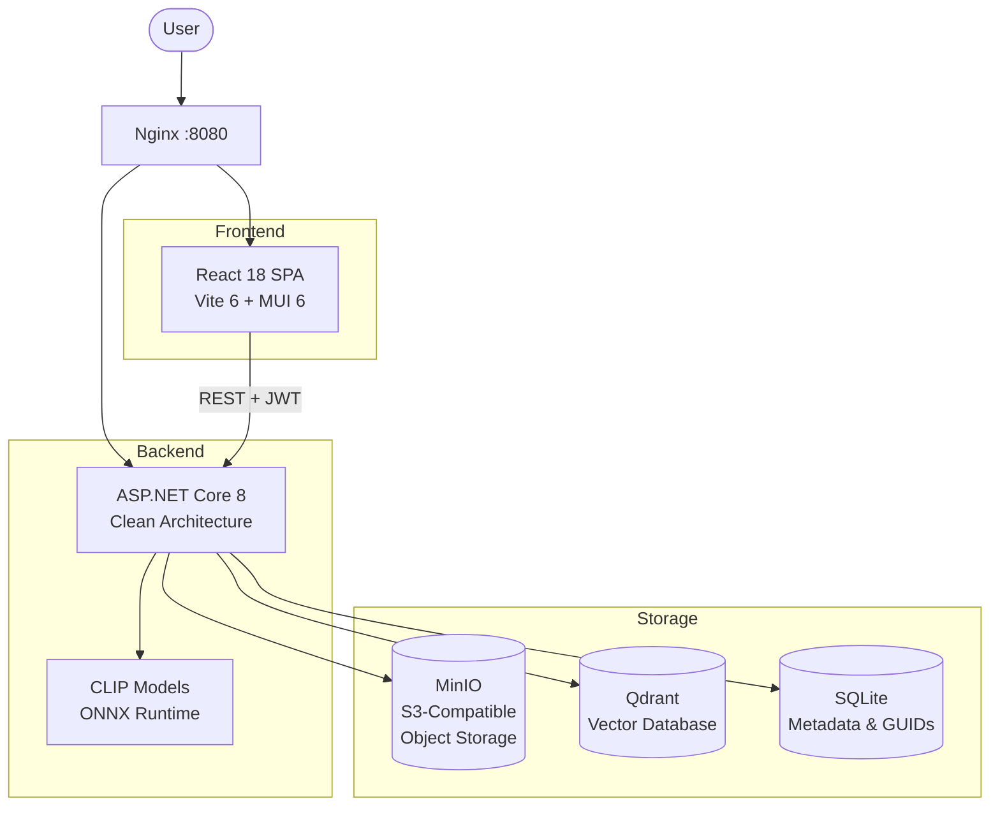
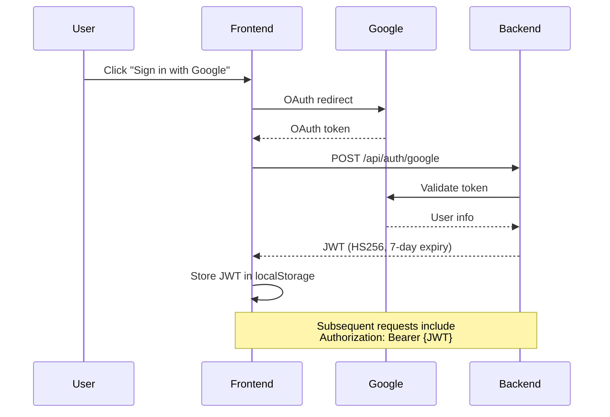
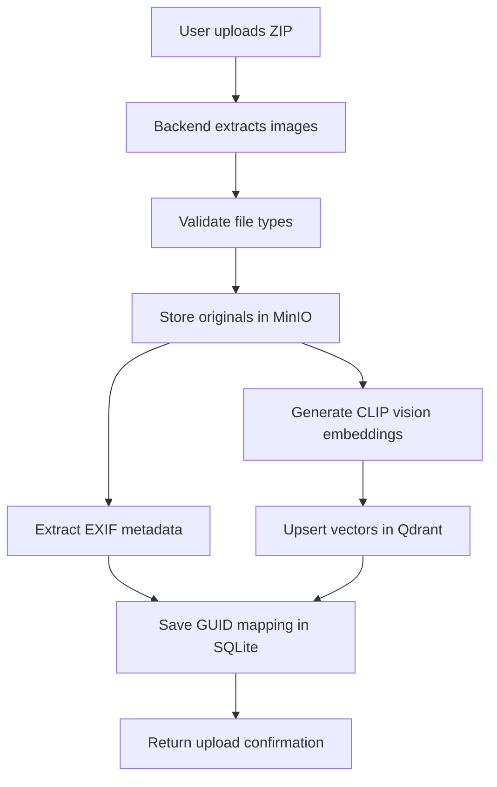
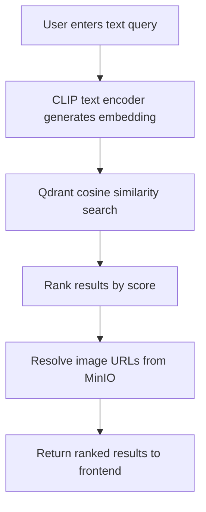
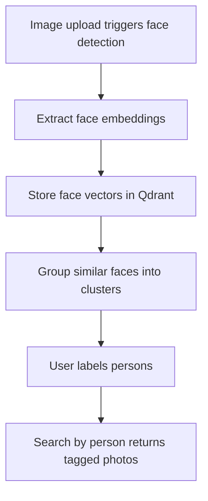
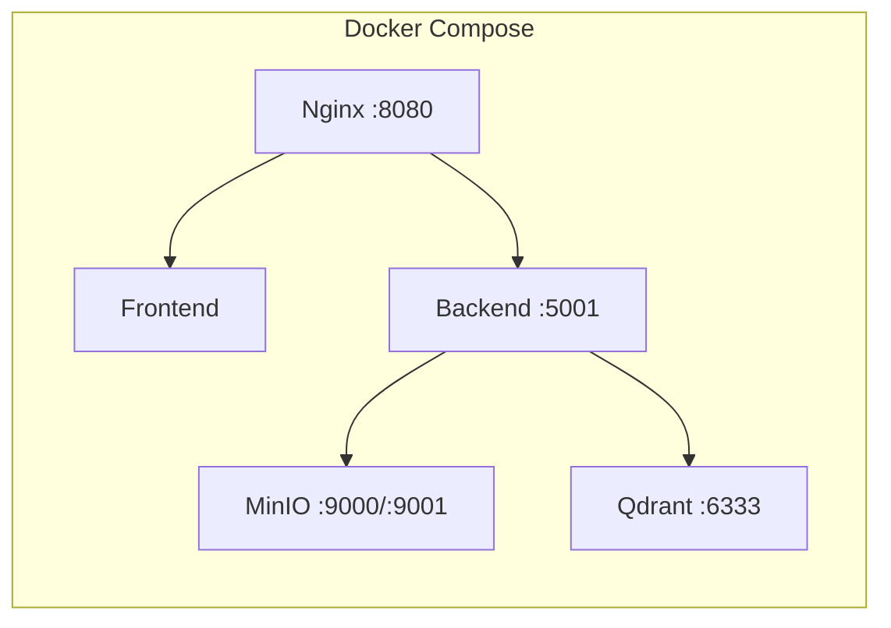

# AzurePhotoFlow Architecture

## System Overview

AzurePhotoFlow is a cloud-native AI-powered photo management application built with open-source technologies for cost-effective deployment. The system uses a containerized architecture orchestrated by Docker Compose (development) or Kubernetes (production).

## Architecture Diagram



## Core Components

### 1. Frontend Application
**Technology**: React 18 + Vite 6 + Material-UI v6

**Responsibilities**:
- Responsive user interface for photo management
- Google OAuth authentication flow
- Photo upload with ZIP file support
- Natural language search interface
- Face recognition tagging interface
- Real-time search results display

**Key Features**:
- Client-side routing with React Router v7
- State management with React Query v3
- HTTP client with Axios
- JWT token management
- Progressive Web App capabilities

### 2. Backend API
**Technology**: ASP.NET Core 8 Web API

**Architecture Pattern**: Clean Architecture with dependency injection

**Controllers**:
- `ImageController`: Photo uploads, project management, metadata extraction
- `SearchController`: Vector similarity search and natural language queries
- `AuthController`: Google OAuth integration and JWT token management
- `EmbeddingController`: AI model inference and vector generation
- `OCRController`: Text extraction from images
- `FaceRecognitionController`: Face detection and person tagging

**Services**:
- `EmbeddingService`: CLIP vision and text model interface for vector generation
- `ImageUploadService`: File processing and storage management
- `SearchService`: Query processing and result ranking
- `VectorStore`: Qdrant database abstraction
- `MetadataExtractorService`: EXIF data processing

### 3. AI/ML Engine
**Technology**: OpenAI CLIP vision and text transformers on ONNX Runtime

**Model Variants**:

| Variant | Model | Embedding Dimensions | Notes |
|---------|-------|---------------------|-------|
| Base | `clip-vit-base-patch32` | 512 | Default — fastest, lowest resource usage |
| Large | `clip-vit-large-patch14` | 768 | Balanced accuracy & performance |
| Huge | `clip-vit-huge-patch14` | 1024 | Best accuracy, most resource intensive |

The active variant is configured via the `EMBEDDING_DIMENSION` and `EMBEDDING_MODEL_VARIANT` environment variables and can be switched using `make models-512`, `make models-768`, or `make models-1024`.

**Processing Details**:
- Cross-platform inference with ONNX Runtime
- BPE tokenization with max 77 tokens for text input
- 224x224 pixel image input size
- Cosine similarity for vector comparison (configurable to Dot or Euclidean)
- Local processing — no external API costs

**Capabilities**:
- Semantic image understanding using vision encoder
- Natural language query processing using text encoder
- Accurate text-to-image similarity scoring in shared CLIP embedding space
- Face detection and recognition
- OCR text extraction

### 4. Storage Systems

#### Object Storage (MinIO)
**Technology**: MinIO S3-compatible object storage

**Organization**:
```
Bucket Structure:
├── {year}/
│   └── {timestamp}/
│       └── {projectName}/
│           └── {directoryName}/
│               └── {fileName}
```

**Features**:
- S3-compatible API
- Hierarchical organization
- Direct URL access with signed URLs
- EXIF metadata preservation
- Multi-format support (JPEG, PNG, TIFF, etc.)

#### Vector Database (Qdrant)
**Technology**: Qdrant vector similarity search engine

**Collections**:
- Environment-specific collection names (configured via `QDRANT_COLLECTION`)
- 512, 768, or 1024-dimensional CLIP embeddings (configurable)
- Cosine similarity search (default, configurable)
- Metadata stored as payload alongside vectors

**Data Model**:
```json
{
  "id": "uuid",
  "vector": [512/768/1024 float values],
  "payload": {
    "object_key": "storage/path/to/image.jpg",
    "file_name": "image.jpg",
    "guid": "unique-image-guid",
    "project_name": "vacation_photos",
    "year": "2024",
    "upload_timestamp": "2024-01-01T12:00:00Z"
  }
}
```

#### Metadata Database (SQLite)
**Technology**: SQLite with Entity Framework Core

Stores image GUID mappings and metadata that complement the vector payloads. The database file is persisted via a Docker volume at `/app/data/photoflow.db`.

### 5. Authentication & Security
**Technology**: Google OAuth 2.0 + JWT tokens

**Flow**:



**Security Features**:
- HTTPS-only communication
- JWT token expiration (7-day default)
- Role-based access control
- CORS configuration
- Input validation and sanitization

## Data Flow Patterns

### Image Upload Flow



### Search Flow



### Face Recognition Flow



## Deployment Architecture

### Development Environment



All services run as Docker containers via `docker-compose.yml`. The backend container mounts the `models/` directory for ONNX model access and a Docker volume for SQLite persistence.

### Production Environment
```
Kubernetes Cluster (MicroK8s):
├── Namespace: azurephotoflow
├── Ingress: NGINX with SSL
├── Deployments:
│   ├── frontend-deployment (3 replicas)
│   ├── backend-deployment (3 replicas)
│   ├── minio-deployment (1 replica)
│   └── qdrant-deployment (1 replica)
├── Services: Load balancing
├── PersistentVolumes: Data persistence
└── ConfigMaps/Secrets: Configuration
```

### Container Images
- **Frontend**: Multi-stage Dockerfile — Node build + Nginx serving
- **Backend**: .NET 8 runtime with ONNX models mounted via volume
- **Storage**: Official MinIO and Qdrant images

## Performance Characteristics

### Scalability
- **Horizontal scaling**: Frontend and backend can scale independently
- **Load balancing**: Nginx distributes requests across replicas
- **Caching**: React Query caches API responses on the client
- **Database**: Qdrant handles large vector collections efficiently

### Performance Metrics
- **Search latency**: <500ms for similarity search
- **Upload throughput**: Depends on network and storage
- **Concurrent users**: Scales with replica count
- **Storage efficiency**: Vector compression in Qdrant

## Technology Stack Summary

| Component | Technology | Version | Purpose |
|-----------|------------|---------|---------|
| Frontend | React | 18.x | User interface |
| Build Tool | Vite | 6.x | Development and bundling |
| UI Framework | Material-UI | 6.x | Component library |
| Backend | ASP.NET Core | 8.x | API server |
| AI Model | CLIP | ONNX | Semantic embeddings (512/768/1024D) |
| Object Storage | MinIO | Latest | File storage |
| Vector DB | Qdrant | Latest | Similarity search |
| Metadata DB | SQLite + EF Core | — | GUID mapping & metadata |
| Orchestration | Kubernetes | 1.20+ | Container management |
| Reverse Proxy | Nginx | Latest | Load balancing |
| Authentication | Google OAuth | 2.0 | User authentication |

## Key Design Decisions

### Cost Optimization
- **Open-source stack**: Eliminates cloud service costs
- **Self-hosted infrastructure**: Full control over resources
- **Local AI processing**: No external API charges for CLIP inference
- **Efficient storage**: S3-compatible with local deployment

### Scalability Strategy
- **Containerized architecture**: Independent scaling of services
- **Stateless design**: Easy horizontal scaling for frontend and backend
- **Container-first**: Cloud-native deployment via Docker and Kubernetes
- **Background processing**: Async embedding generation during uploads

### Performance Focus
- **Vector search**: Optimized cosine similarity via Qdrant
- **Caching layers**: Client-side caching with React Query
- **Configurable models**: Trade off between accuracy and speed with 3 CLIP variants
- **Efficient protocols**: HTTP/2, compression

### Security Considerations
- **Zero-trust model**: Authentication on all API endpoints
- **Encrypted communication**: HTTPS everywhere in production
- **Input validation**: Comprehensive sanitization
- **Access control**: JWT-based authorization with role claims
